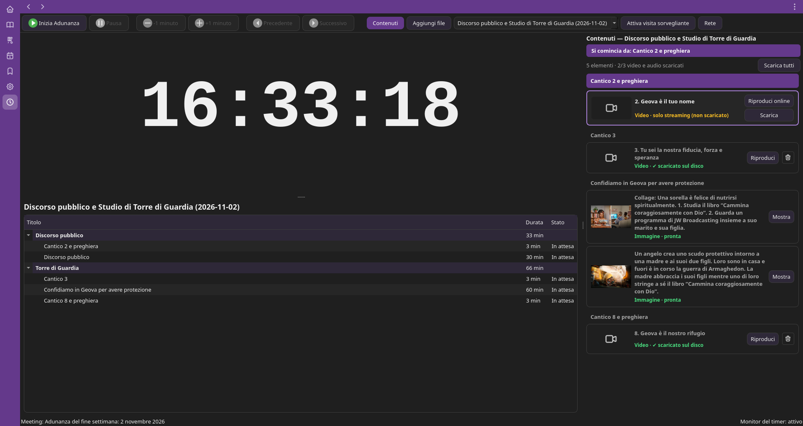
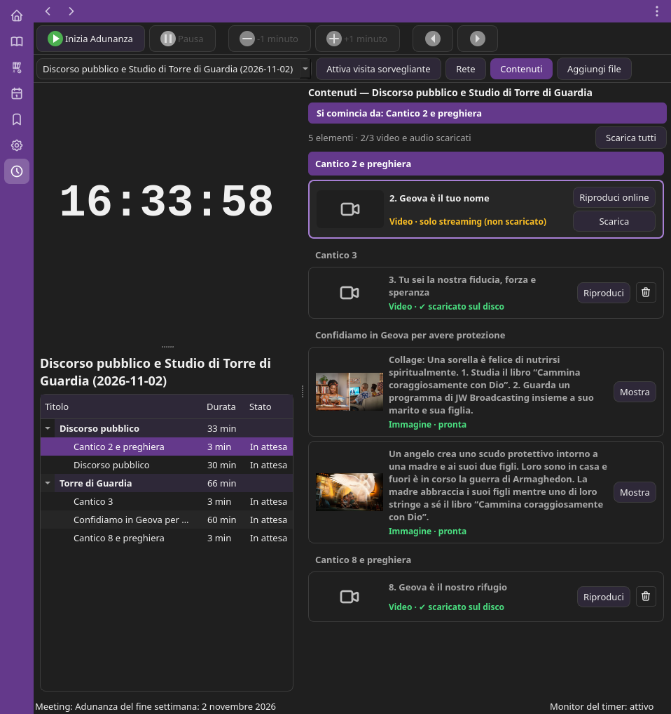
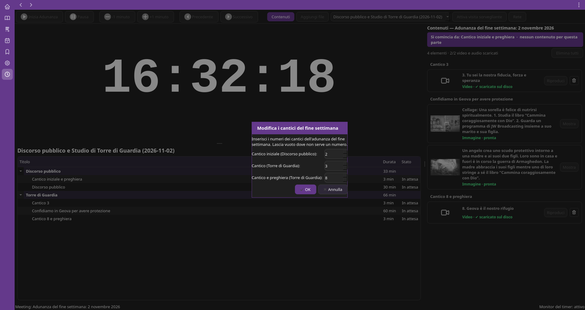

# JW-LibriX-timer

Plugin **Timer adunanze** per [JW-LibriX](https://github.com/zimu96/JW-LibriX),
l'app JW Library per Linux.

Basato su OnTime Meeting Timer 1.0.9 (MIT), adattato a JW-LibriX.

## Com'è

A metà schermo, con Zoom accanto (com'è pensato per l'adunanza):

Quando mancano i numeri dei cantici del fine settimana, il timer li chiede:

## Cosa fa

- Conto alla rovescia delle parti dell'adunanza, con le durate prese dal programma.
- Monitor secondario a schermo intero (anche su un altro schermo o in rete) con il tempo, l'orologio e la parte successiva.
- Si accende e si spegne dalle Impostazioni: quando è acceso compare il tasto con l'orologio nella barra viola.

## Installare

Non serve scaricare niente a mano. In JW-LibriX:

**Impostazioni > Plugin > Installa**

Il plugin viene scaricato da qui e salvato nella cartella dei dati, in
`plugin/timer/`. Lo stesso tasto diventa **Aggiorna** quando c'è una versione nuova.

Installazione manuale: copia il contenuto di questo repository in `plugin/timer/`
dentro la cartella dei dati di JW-LibriX.

## Versioni

Si scarica solo l'ultima versione: oggi la **1.0.5**. JW-LibriX (dalla 1.0.2)
installa e aggiorna sempre l'ultima; le app più vecchie chiedono il tag `v1.0.0`,
che per questo punta sempre al codice più recente.

### 1.0.5 — l'ultima

Sostituisce tutte le precedenti.

- **Pop-up**: rispondono sempre e arrivano uno alla volta, nell'ordine giusto; l'app non si
  blocca più, anche con lo schermo esterno dei video acceso.
- **Avvio dell'app**: il monitor del timer non ferma più la schermata di avvio.
- **A metà schermo**: il titolo va a capo, la scaletta lascia lo spazio ai titoli (il titolo
  intero passando col mouse), «Contenuti» e «Aggiungi file» scendono nella seconda riga quando
  non ci stanno. A schermo intero resta tutto come prima.

### 1.0.3 – 1.0.4

- **Partenza in ritardo**: se l'adunanza inizia dopo l'ora fissata il tasto «Inizia» funziona
  normalmente e il ritardo viene tolto, a pochi secondi per volta, dalle parti ancora da fare
  (mai da cantici e preghiere), così si finisce in orario. Un avviso dice quanto è stato tolto.
- **Pop-up dentro l'app**: avvisi e domande stanno al centro della finestra dell'app, qualunque
  sia la sua grandezza (anche a mezzo schermo), e non finiscono più sotto altre finestre.
- **Italiano**: «Sì / No / Annulla» al posto di Yes / No / Cancel, «Ritardo» nella barra in
  basso, editor delle adunanze e avvisi ancora in inglese.
- **Precedente / Successivo**: nel minuto del presidente «Precedente» non fa più saltare una
  parte; il lampeggio del tasto non resta acceso e il tasto non sparisce più.
- **Adunanza scelta dall'elenco**: il timer usa davvero quella scelta (prima restava su quella
  di prima, e contenuti e parti non coincidevano).
- **A mezzo schermo**: le scritte sotto le cifre si rimpiccioliscono per starci intere; il
  pannello Contenuti, il titolo e la barra in basso non allargano più la finestra.
- **Avviso «Pronti a cominciare?»**: era una finestra a parte che, a mezzo schermo poteva coprire i tasti e bloccare «Inizia»; ora sta dentro l'app e sparisce sempre.
- **Pop-up «Modifica i cantici»**: il tasto OK ora risponde sempre (prima un separatore invisibile tra i pannelli prendeva i clic).
- **Cantici del fine settimana**: dopo aver inserito i numeri dei cantici la schermata del timer non si sposta più fuori posto e i tasti restano utilizzabili.
- Il monitor del timer torna da solo sullo schermo scelto (anche se lo schermo compare dopo).
- Aprendo il timer non compaiono più due pop-up uno sopra l'altro.

### 1.0.0 – 1.0.2

Prima versione e prime correzioni.

## Licenza

MIT, vedi `LICENSE`.
